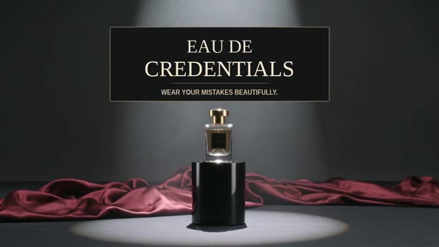
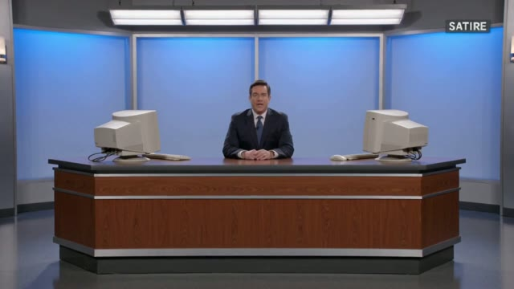

<div align="center">

# OFF-BRAND

**The internet’s knockoff aisle. Real phishing sites reviewed by me GnomeMan4201**

[](https://gnomeman4201.github.io/Off-Brand/)

### [TUNE IN — WATCH OFF-BRAND AFTER DARK](https://gnomeman4201.github.io/Off-Brand/)

**Real captures. Questionable programming. No actual sponsors.**

</div>

---

## What exactly am I watching?

Off-Brand is a screenshot comedy zine disguised as a late-night television station. Each channel is a real captured page from a public scan record, reviewed for what it shows, what makes it suspicious, and what can actually be established from the evidence.

I started with a simple idea: the internet has an entire knockoff aisle, and somebody ought to review the merchandise.

The joke is the introduction, not the investigation. A terrible-looking page can be harmless. A convincing page can be dangerous. I want people to come for the ridiculous websites and leave knowing how to question a convincing one.

## Tonight's programming

| On air | What you're getting |
| --- | --- |
| **The broadcast** | Channel-surf through reviewed specimens, with satirical captions, verdicts and ratings. |
| **What to Notice** | Defanged addresses, scan metadata, visible warning signs, social engineering observations and practical verification advice. |
| **Tonight's lineup** | Search by brand, domain or tell, or filter the collection by aisle. |
| **CH 00 — Off-Brand Originals** | Fictional late-night commercials, available on demand and during optional commercial breaks. |
| **Held back at review** | Records that did not meet the publication standard, with reasons for exclusion. |
| **Phishing field guide** | Practical steps for recognizing, verifying and reporting suspicious requests. |

[**Open the station →**](https://gnomeman4201.github.io/Off-Brand/)

## Behind the joke: What to Notice

The screenshot is only one part of the story. The fact file separates the comedy from the evidence and points readers back to the public record.

For example, one published specimen presents a USPS redelivery payment screen. The review identifies a small $1.95 fee alongside a request for extensive payment and contact details. It also notes that the captured hostname does not match USPS's official domain. The useful lesson is not whether the design looks convincing: it is whether the request makes sense and can be verified independently.

**[View the reviewed specimen](https://gnomeman4201.github.io/Off-Brand/#urlscan-01a1a583-5919-702e-b4e1-d2330a5d977e)** · [Public scan record](https://urlscan.io/result/01a1a583-5919-702e-b4e1-d2330a5d977e/)

A source classification or a visible warning sign is not proof that credentials were stolen. The review is limited to the available evidence.

## And now, a word from absolutely nobody

**CH 00 — Off-Brand Originals**

The station has its own fictional commercials, questionable testimonials, weather reports and public-access programming.

| [Eau de Credentials](https://gnomeman4201.github.io/Off-Brand/#originals) | [The Phishing Forecast](https://gnomeman4201.github.io/Off-Brand/#originals) |
| :---: | :---: |
|  |  |
| Luxury fragrance for the person who shares everything. | Scattered login showers and a fake invoice front. |

<div align="center">

[](https://gnomeman4201.github.io/Off-Brand/#originals)

**Gary’s Testimonial** — A satisfied customer explains exactly what he consented to.

[Watch the commercials on CH 00](https://gnomeman4201.github.io/Off-Brand/#originals)

</div>

All commercial imagery above is fictional promotional material from the project, not evidence from phishing scans. Creative production may be AI-assisted.

---

## Editorial standards

The specimens are real captured pages, not reconstructed scam websites. Each published review links to its public record. Source classifications are attributed to their sources; a suspicious or reported page is not automatically confirmed phishing. A screenshot documents one moment and cannot establish everything that happened before or after capture.

The ratings and verdicts are satirical editorial judgments, not measured risk scores. The comedy targets deceptive design, not victims, nationalities or the brands being impersonated. Missing evidence is identified as missing rather than filled in with guesses.

Reviews are subject to editorial approval. See the [editorial guide](VOICE.md) for review standards.

## Safety and privacy

- Suspect addresses are defanged and are not clickable.
- Collection reads public scan records and feeds rather than visiting suspect sites.
- Captured text is treated as untrusted data and displayed as plain text.
- The site uses a restrictive content security policy. Screenshots are served from urlscan.io; commercial media, fonts and sounds are served locally.
- A source may remove a public screenshot or record at any time. Its scan date is not proof that the suspect site is still active.
- Unapproved archived specimens and draft reviews are maintained separately in a private repository.

Off-Brand is an editorial publication, not a real-time phishing detector, blocklist or substitute for independent verification.

## Under the hood

Off-Brand is a static site published using GitHub Pages. GitHub Actions supports collection, editorial approval, publication and deployment.

```text
Public scan records / candidate feeds
              |
              v
       Collection and triage
              |
              v
       Evidence review
              |
              v
     Explicit editor approval
              |
              v
      Published review data
              |
              v
       Off-Brand After Dark
```

| Path | Purpose |
| --- | --- |
| `site/` | Broadcast interface, player, commercial assets and local resources |
| `data/reviews.json` | Published reviews and excluded-record log |
| `data/voices.json` | Editorial voice and tone definitions |
| `data/seen.json` | Candidate deduplication |
| `scripts/` | Collection, sanitization, archive and publication tooling |
| `.github/workflows/` | Collection, approval and deployment workflows |
| `tests/` | Automated regression tests |

Read the [maintenance documentation](docs/MAINTAINING.md) for configuration, review publication, commercial management and local testing.

## Credits

Public scan records and screenshots: [urlscan.io](https://urlscan.io). Candidate-feed fallback: [OpenPhish](https://openphish.com). The currently published review collection uses public urlscan records.

[Broadcast sound sources](site/sounds/SOURCES.md) · [Font licenses](site/fonts/)

Off-Brand is a [badBANANA Research Collective](https://badbananaresearch.com) project.

---

<div align="center">

**Please do not adjust your set. Adjust your expectations.**

[Back to the broadcast](https://gnomeman4201.github.io/Off-Brand/)

</div>
