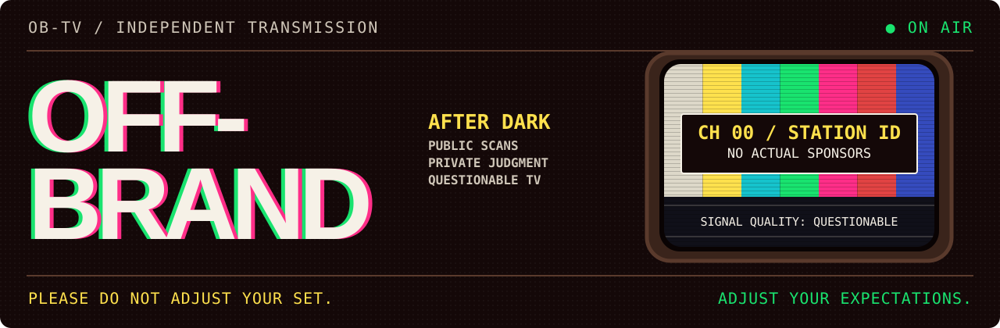
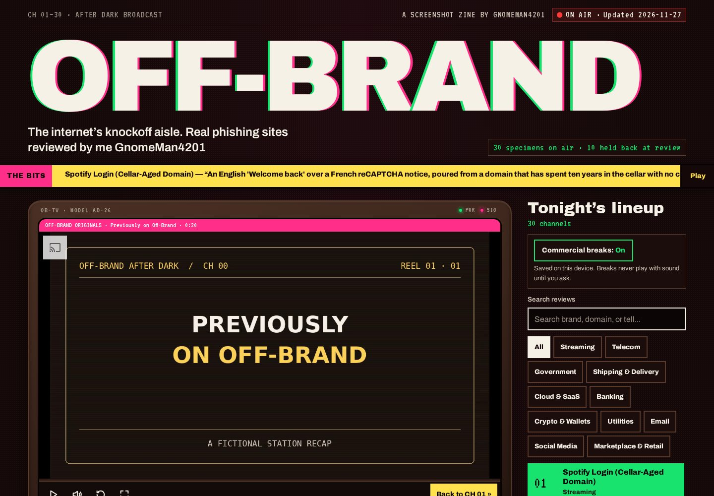
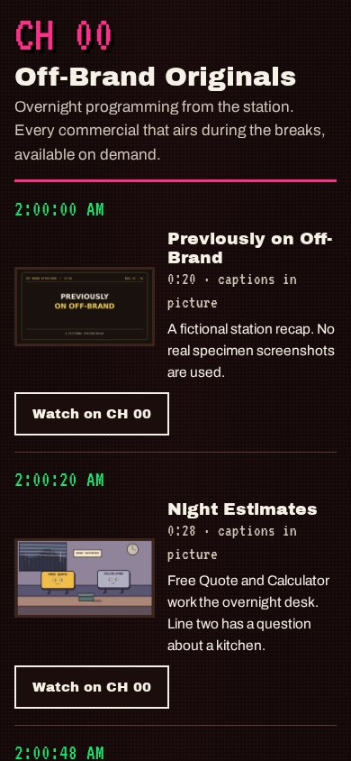
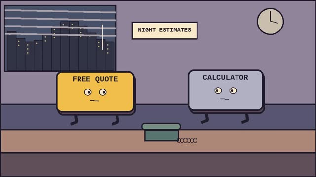
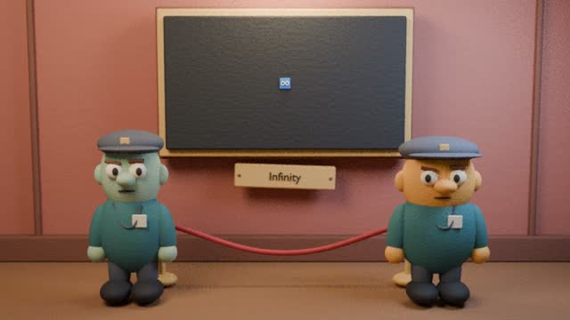

# OFF-BRAND

**The internet’s knockoff aisle. Real phishing sites reviewed by me GnomeMan4201**

[**WATCH THE BROADCAST ↗**](https://gnomeman4201.github.io/Off-Brand/) · [Editorial standards](VOICE.md) · [Station maintenance](docs/MAINTAINING.md)

---

## Somewhere between a security blog and a television station nobody asked for.

I collect real pages from public phishing scan records, review them, and turn them into late-night television.

There are channels, questionable commercials, a ticker full of bad decisions, and an actual investigation hiding underneath the jokes.

Some pages look ridiculous. Some look exactly like the real thing. That's the part worth paying attention to.

Desktop capture of the deployed interface, November 27, 2026. CH 00 is playing fictional station programming.

## The good stuff is underneath the joke.

Every reviewed specimen has a **What to Notice** section. That's where the comedy stops and the evidence starts.

| From the broadcast | From the fact file |
| --- | --- |
| [Spotify Login (Cellar-Aged Domain)](https://gnomeman4201.github.io/Off-Brand/#urlscan-01a1f8dd-b83d-7541-b503-42125f30510e) | A familiar sign-in screen hosted in an unrelated domain's images directory. |
| [Netflix Sign-In (Site-Builder Edition)](https://gnomeman4201.github.io/Off-Brand/#urlscan-01a217c3-10b8-71e9-ba7a-64c078f954cc) | A convincing copy on a website-builder subdomain rather than the service's own domain. |
| [USPS Redelivery (Card Required)](https://gnomeman4201.github.io/Off-Brand/#urlscan-01a1a583-5919-702e-b4e1-d2330a5d977e) | A small redelivery fee alongside a request for extensive payment and contact information. |

Each links to a published review with its source record. These observations describe the available evidence; they do not establish that anyone's credentials were stolen.

The point isn't to get better at spotting ugly websites. It's to get better at questioning convincing ones.

---

## We'll be right back after these questionable messages.

<table>
<tr>
<td width="37%" valign="top">

</td>
<td width="63%" valign="top">
<h3>CH 00 — Off-Brand Originals</h3>

Because apparently a phishing zine needed its own commercial breaks.

<b>Night Estimates.</b> Free Quote and Calculator work the overnight desk.

<b>Somebody Stole Infinity.</b> Two museum guards. One missing exhibit. Thirty-two pixels of trouble.

<a href="https://gnomeman4201.github.io/Off-Brand/#originals"><b>WATCH CH 00 ↗</b></a>

</td>
</tr>
</table>

Mobile interface capture, November 27, 2026. The commercials are fictional productions, may be AI-assisted, and are not phishing evidence. No actual sponsors.

---

## Not everything makes it on air.

A report is a lead, not a verdict. Some records are held back when the evidence doesn't support publication. The site includes the reasons for exclusion, as well as a field guide for recognizing, verifying and reporting suspicious requests.

**The captures are real. The commercials are fictional. The ratings are jokes. The source records are evidence.**

<b>Station policy — evidence, editorial standards and safety</b>

- Each published review links to a public scan record. Captures document a moment, not the entire history or behavior of a site.
- Source classifications are attributed to their sources. Suspicious or reported does not automatically mean confirmed phishing.
- Each new review carries an Evidence Locker: a level (Corroborated, Source-confirmed, Suspected, Unverified or Disputed), the reason for it, the records behind it and the sources that could not be checked. Earlier reviews are marked Not yet rated.
- Ratings and verdicts are satirical editorial judgments, not measured risk scores. Comedy targets deceptive design, not victims, nationalities or impersonated brands.
- Missing evidence is identified as missing. Publication requires editorial approval.
- Suspect addresses are defanged and non-clickable. Collection reads public scan records and feeds rather than visiting suspect sites.
- Captured text is treated as untrusted data and rendered as plain text. A restrictive content security policy limits resources; scan screenshots are served from urlscan.io, while commercial media, fonts and sounds are local.
- Public records and screenshots may disappear; a scan date does not establish that a site is still active. Unapproved specimens and drafts are maintained separately in a private repository.
- Off-Brand is an editorial publication, not a detection service or live blocklist.

Read the [editorial guide](VOICE.md).

<b>Behind the broadcast — repository and maintenance</b>

Off-Brand is a static GitHub Pages site. GitHub Actions handles collection, review, explicit editorial approval and publication.

| Path | Purpose |
| --- | --- |
| `site/` | Broadcast interface, player, commercials and local resources |
| `data/reviews.json` | Published reviews and exclusion log |
| `data/voices.json` | Editorial voices and tone |
| `data/seen.json` | Candidate deduplication |
| `scripts/` | Collection, sanitization, archive and publication tooling |
| `.github/workflows/` | Collection, approval and deployment |
| `tests/` | Automated regression tests |
| `docs/media/` | README station artwork and interface captures |

See [maintenance documentation](docs/MAINTAINING.md) for setup, publication, commercial management and local checks.

Public scan records and screenshots: [urlscan.io](https://urlscan.io). Private research cross-check: [OpenPhish](https://openphish.com); public fallback disabled. Published reviews currently use public urlscan records.

[Sound credits](site/sounds/SOURCES.md) · [Font licenses](site/fonts/) · [badBANANA Research Collective](https://badbananaresearch.com)

---

**THIS CONCLUDES ABSOLUTELY NOTHING.**

[**RETURN TO THE BROADCAST ↗**](https://gnomeman4201.github.io/Off-Brand/)

### Station standards and corrections

The [public methodology page](https://gnomeman4201.github.io/Off-Brand/methodology.html) explains evidence levels, source limitations, editorial review and correction reporting. It does not confer a new rating on historical reviews or authorize provider reuse.
